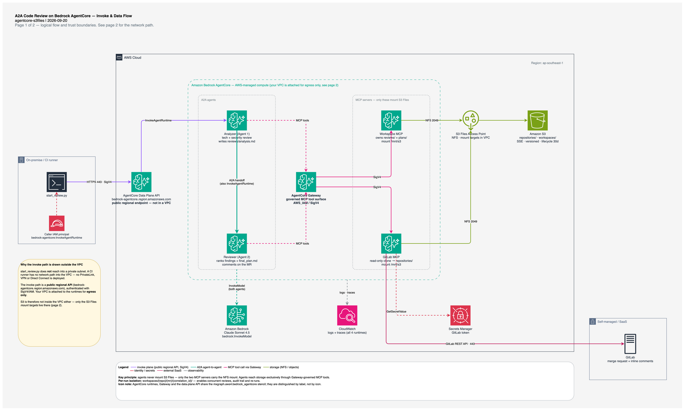

# Shared Persistent Storage for Multi-Agent AI Workflows

### Amazon Bedrock AgentCore Runtime + Amazon S3 Files

[](LICENSE)


Enable multiple AI agents running in **separate Amazon Bedrock AgentCore Runtime
containers** to share a **persistent filesystem backed by Amazon S3**, so agents can
collaboratively read and write files — source-code repositories, analysis plans, task
definitions — without redundant data transfers or ephemeral-storage limitations.

> **Important**: This is sample code for demonstration and educational purposes. It is not
> intended for production use without additional security review, testing, and hardening.
> See [SECURITY.md](SECURITY.md) for known limitations and production recommendations.



---

## Table of contents

- [Intent](#intent)
- [Motivation](#motivation)
- [Applicability](#applicability)
- [Architecture](#architecture)
- [Repository layout](#repository-layout)
- [Prerequisites](#prerequisites)
- [Quick start](#quick-start)
- [Implementation walkthrough](#implementation-walkthrough)
- [Resources created](#resources-created)
- [Security](#security)
- [Findings and lessons learned](#findings-and-lessons-learned)
- [Testing](#testing)
- [Costs and cleanup](#costs-and-cleanup)
- [Contributing](#contributing)
- [License](#license)

---

## Intent

Give multiple AI agents in separate AgentCore Runtime containers access to a shared,
persistent filesystem backed by Amazon S3 using Amazon S3 Files (NFS). Agents in a
workflow chain (analyze a merge request → review & comment) can pass
large artifacts through standard filesystem operations instead of re-transferring data.

## Motivation

When building multi-agent AI systems on AgentCore Runtime, each agent runs in its own
isolated container. Agents in a workflow chain need to share artifacts — cloned
repositories, analysis plans, task lists. Without shared storage:

- Files written by one agent (e.g., a review analysis) are invisible to downstream agents.
- Ephemeral container storage is lost when the agent session ends.
- There is no audit trail of what each agent produced.

**Amazon S3 Files** provides NFS-based filesystem access to S3 buckets, letting multiple
AgentCore containers mount the same bucket and share files through ordinary filesystem
operations.

## Applicability

**Use this pattern when:**

- Multiple AgentCore Runtime agents need to share files in a workflow chain.
- Agent-produced artifacts (analyses, plans) must persist beyond the agent session and be
  handed from one agent to the next.
- You need an audit trail of all files produced during a workflow.

**Do _not_ use this pattern when:**

- Agents only need to pass small text messages (use the A2A protocol directly).
- Each agent operates independently with no shared state.
- Real-time file synchronization is required (S3 Files has a 1–2 minute sync delay to S3).

## Architecture

Agents never touch the filesystem directly. All file operations go through **MCP server
tools** running on containers that carry dedicated S3 Files NFS mounts under `/mnt`. AgentCore
mounts the filesystem natively via `filesystem_configuration.s3_files_access_point` — no
`mount` commands, `nfs-utils`, or `amazon-efs-utils` are needed in the container.

### S3 folder structure

```
s3://{bucket}/
├── repositories/
│   └── {repo_name}/
│       └── {mr_id}/                 # Read-only shallow clone of the MR source
│           └── ... (full source, for context beyond the diff)
│
└── workspaces/
    └── {repo_name}/
        └── {mr_id}/
            └── {correlation_id}/    # Per-run isolation (unique per workflow invocation)
                ├── reviews/
                │   └── analysis.md      # written by the Analyzer (tech + security)
                └── plans/
                    └── final_plan.md    # written by the Reviewer (ranked findings)
```

Each workflow invocation receives a unique **`correlation_id`** (e.g.
`20260804-091412-b7c37234`) that isolates its artifacts from other runs on the same MR.
This means you can re-review an MR after a new push, run concurrent reviews, and retain a
full audit trail — previous runs are never overwritten.

The MR's source is **shallow-cloned read-only** onto S3 Files under `repositories/` so agents
can open **any** file for context (callers, imports, related code), not just the changed
hunks. The clone is strictly read-only — the workflow **never** creates branches, commits,
pushes, or opens new merge requests; it only reads the source and posts comments back.

### Key design decisions

1. **Per-MR workspace isolation** — each merge request gets its own prefix at
   `workspaces/{repo_name}/{mr_id}/{correlation_id}/` so concurrent reviews don't clobber
   each other's artifacts. The `correlation_id` (generated per invocation or supplied by
   CI) ensures repeated reviews on the same MR are fully isolated with a complete audit
   trail.
2. **Read-only clone for full context** — the MR source is shallow-cloned (`--depth 1`)
   onto S3 Files at `repositories/{repo_name}/{mr_id}/`. The diff shows *what* changed;
   the clone lets agents read *any* file for context. It is clone-only — **no** branches,
   commits, pushes, or new MRs. The analyzer clones once; the reviewer reads the SAME clone.
3. **Native AgentCore S3 Files mounts** — dedicated access points are mounted under
   `/mnt` automatically. No manual
   NFS utilities in the container.
4. **Agents never access the filesystem directly** — all file I/O goes through MCP
   server tools running on containers with the mount. Agent containers do not have it.
5. **Deterministic MCP session IDs** — the same agent always routes to the same MCP

> **Container images, deliberately different.** The **Workspace MCP** and **GitLab MCP**
> images mount separate S3 Files access points — Workspace owns `/mnt/workspaces`, while
> GitLab owns the read-only `/mnt/repositories` clone. The **agent** images install **no** NFS/S3-Files tooling and
> the agent code is given **no** local file tools — so agents reach shared storage only through
> the MCP servers, never the filesystem directly (Lesson 7).

### The workflow: end-to-end review (analyzer → reviewer)

Two agents split the job end-to-end, with **no external orchestrator** — the analyzer hands
off to the reviewer directly over A2A:

| Component | Runtime | Protocol | Mounts S3 Files? | Role |
| --- | --- | --- | --- | --- |
| `scripts/start_review.py` | — (local/CI) | A2A caller | No | Kicks off the workflow by invoking the analyzer |
| **Analyzer** (Agent 1) | own runtime | A2A | No | Combined **technical + security** review → **writes** `reviews/analysis.md`. **Never comments on GitLab.** Then calls the reviewer |
| **Reviewer** (Agent 2) | **separate** runtime | A2A | No | Reads `analysis.md`, **ranks** findings, **writes** `plans/final_plan.md`, posts a **summary comment** and **inline comments** on the changed lines |
| **Workspace MCP** | own runtime | MCP | **Yes** (`/mnt/workspaces`) | Dedicated `workspaces/` access point — `reviews/`, `plans/` |
| **GitLab MCP** | own runtime | MCP | **Yes** (`/mnt/repositories`) | Dedicated `repositories/` access point; read-only **clone**, **fetch MR + diff**, **comment** + **inline comment**. No push/branch/MR |

**Clear separation of duties:**
- The **Analyzer** clones the MR source read-only (`gl_clone_repo`) and reads full files
  (`gl_read_repo_file`, `gl_list_repo_dir`) alongside the diff (`gl_fetch_mr_diff`) to produce
  one combined tech+security assessment, which it writes to shared storage. It has **no**
  commenting tools — it cannot write to GitLab by construction (the wrappers don't exist in its
  build).
- The **Reviewer** is the only agent with commenting tools (`gl_comment`, `gl_inline_comment`).
  It finalizes: ranks the findings, writes the prioritized `final_plan.md`, posts a summary
  note, and drops **inline comments on the specific changed lines** via the GitLab discussions
  API. It never creates a branch or a new MR — it only comments on the given one.

**A2A handoff:** the analyzer's `handoff_to_reviewer` tool signs an `InvokeAgentRuntime`
(A2A `message/send`) call to the reviewer's runtime — the agent itself sequences the workflow,
not an outside driver. `scripts/start_review.py` only invokes the analyzer; the chain
continues from there.

**How the sharing actually works:** agents never touch the filesystem — only the **MCP
servers** mount dedicated S3 Files access points. The analyzer calls the Workspace MCP to write `analysis.md`; the
reviewer (a different runtime) calls the **same** Workspace MCP to read it and write
`final_plan.md`. Both access points back the same bucket but expose separate prefixes, so
the reviewer sees the analyzer's file over shared storage — nothing is re-transferred.

Both agents key off the **same** `repo`/`mr`, so they derive the **same deterministic session
id** and attach to the same workspace. The two MCP runtimes have independent mount caches, so
identifiers are passed explicitly in the A2A message, and writes are given ~1–2 min to sync
(S3 Files sync delay) before the reviewer reads. In Terraform the reviewer runtime is created
first and its id is injected into the analyzer as `REVIEWER_RUNTIME_ID` (a `for_each`
self-reference would be a cycle), so the analyzer can hand off.

## Repository layout

```
agentcore-s3files-shared-storage/
├── README.md                     # This document (the rendered pattern)
├── LICENSE                       # MIT-0
├── SECURITY.md                   # Known limitations and production guidance
├── CONTRIBUTING.md
├── CODE_OF_CONDUCT.md
├── .gitignore
├── docs/
│   ├── architecture-aws-icons.png    # Rendered architecture diagram (AWS icons)
│   └── architecture-aws-icons.drawio # Editable source with AWS icons (draw.io)
├── terraform/
│   ├── README.md                 # Terraform-specific docs (config.yaml, bootstrap, commands)
│   ├── main.tf                   # Root: loads config.yaml + wires modules
│   ├── variables.tf              # Root input variables
│   ├── outputs.tf                # Root outputs
│   ├── providers.tf              # Provider/version constraints
│   ├── environments/
│   │   └── dev/
│   │       └── config.yaml       # Per-environment configuration (the file you edit)
│   └── modules/
│       ├── vpc/                  # VPC + public/private subnets + IGW + NAT
│       ├── ecr/                  # ECR repos (derived from agentcore config) — Phase 1
│       ├── secrets/              # Secrets Manager entry for the GitLab token
│       ├── s3files/              # Bucket + IAM role + S3 Files fs/mount/access points
│       ├── mcp/                  # Shared NFS SG + least-privilege roles + MCP runtimes
│       ├── gateway/              # AgentCore Gateway fronting the MCP runtimes (MCP tool surface)
│       └── agentcore/            # The two A2A agent runtimes (analyzer + reviewer)
├── scripts/
│   ├── start_review.py           # Kicks off the workflow — invokes the analyzer only
│   └── build_and_push.sh         # Build + push all 4 images to their ECR repos
├── src/
│   ├── agents/                   # A2A agents (no mount) — reach storage via MCP only
│   │   ├── analyzer/             # Agent 1 — tech+security → WRITES reviews/analysis.md, then A2A-calls reviewer
│   │   │   ├── agent.py · entrypoint.py · Dockerfile · pyproject.toml · uv.lock
│   │   │   ├── tools/            # mcp_tools.py + a2a_handoff.py (handoff_to_reviewer); NO gl_comment
│   │   │   └── prompts/system_prompt.md
│   │   └── reviewer/             # Agent 2 — ranks, WRITES plans/final_plan.md, COMMENTS to GitLab
│   │       ├── agent.py · entrypoint.py · Dockerfile · pyproject.toml · uv.lock
│   │       ├── tools/            # mcp_tools.py (ws_* + gl_comment)
│   │       └── prompts/system_prompt.md
│   ├── mcp-servers/              # Run with dedicated mounts under /mnt
│   │   ├── workspace/            # plans / tasks / reports  (server.py, Dockerfile, ...)
│   │   └── gitlab/               # read-only clone (S3 Files) + fetch MR/diff + comment/inline
│   └── shared/                   # A2A, gateway, model, and logging helpers
└── tests/
    ├── test_mcp_tools.py
    ├── test_cross_agent_sharing.py
    └── test_gitlab_server_security.py
```

## Prerequisites

- Amazon Bedrock AgentCore Runtime access in your AWS Region.
- AWS permissions to create the Amazon S3, VPC, S3 Files, IAM, AWS KMS, Amazon ECR,
  AWS Secrets Manager, Amazon CloudWatch, and AgentCore resources in this sample.
- Terraform ≥ 1.10, AWS provider ~> 6.50 (the `aws_bedrockagentcore_agent_runtime` resource needs the 6.x line), AWS CLI v2, Docker, Python 3.13.

## Quick start

Configuration is driven by `terraform/environments/dev/config.yaml`. Deployment is a
two-phase bootstrap **because the AgentCore runtimes reference ECR images that must be
built and pushed first** — S3 Files itself is created in a single apply and is *not* the
reason for the split. See [`terraform/README.md`](terraform/README.md) for the full
explanation.

```bash
cd terraform

# ── Initialise Terraform (downloads the aws / null / external providers) ──
# -upgrade reconciles provider versions with providers.tf; run once per checkout
# and whenever provider constraints change.
cp environments/terraform.tfvars.example environments/dev/terraform.tfvars
# Edit the copied file (region + naming); account = your AWS_PROFILE
terraform init -upgrade

# Format + validate before planning
terraform fmt -recursive
terraform validate

# ── Phase 1: VPC + security group + ECR repos + S3 Files (bucket/fs/access point) + IAM ──
# config.yaml: vpc.create_vpc: true, agentcore.create_runtimes: false
# Always plan to a file, review it, then apply exactly that plan.
terraform plan  -var-file=environments/dev/terraform.tfvars -out=tfplan
terraform show  tfplan | less            # review the plan
terraform apply tfplan                   # apply the reviewed plan (no -var needed)

# ── Build & push all 4 images to the Phase-1 ECR repos ──
# Reads ecr_repository_urls from terraform output, logs in, builds each Dockerfile
# and pushes it. Region/tag/platform are overridable via env (defaults shown).
cd ..
AWS_REGION=ap-southeast-1 IMAGE_TAG=latest PLATFORM=linux/arm64 \
  ./scripts/build_and_push.sh                 # all four
# ./scripts/build_and_push.sh analyzer-agent  # or a subset
# No config edit needed — each runtime's image defaults to its derived ECR repo
# (<project>-<env>-<key>-agent / -mcp) at agentcore.image_tag. Override only via an
# optional container_uri in config.yaml if you push somewhere else.
cd terraform

# ── Phase 2: the AgentCore runtimes (MCP servers + agents) ──
# flip config.yaml: agentcore.create_runtimes: true   (images come from the Phase-1 ECR repos)
terraform plan  -var-file=environments/dev/terraform.tfvars -out=tfplan
terraform apply tfplan

# ── Kick off a review (invokes the analyzer; it hands off to the reviewer via A2A) ──
export ANALYZER_RUNTIME_ID=$(terraform output -raw analyzer_runtime_id)
cd ..
python scripts/start_review.py --repo-name demo-repo --mr-id 42 \
  --repo-url https://gitlab.com/acme/demo-repo --project-id 123 --mr-iid 7
# A unique correlation_id is generated automatically (e.g. 20260804-091412-b7c37234).
# To supply your own (e.g. from CI): --correlation-id "ci-pipeline-12345"

# ── Run the tests ──
cd tests && python -m pytest -v
```

> **Sequencing:** the container images must be built and pushed before the runtimes reference
> them, so the deploy runs in two phases. Phase 1 stands up the base infrastructure (VPC, ECR,
> and the full S3 Files stack: bucket, filesystem, mount targets, and access points). A single
> `create_runtimes` flag drives Phase 2, which creates the runtimes — ordered automatically by
> value dependency (runtimes reference their access point ARNs and each other's runtime IDs).

> Already have a VPC? Set `vpc.create_vpc: false` in `config.yaml` and fill in `id` +
> `private_subnet_ids`. See [`terraform/README.md`](terraform/README.md) for all config keys.

## Implementation walkthrough

The full step-by-step implementation — S3 Files filesystem creation, the MCP server,
deploying it as an AgentCore runtime, agent tool wrappers, and A2A wiring — is documented
inline in the source files under [`terraform/`](terraform/) and [`src/`](src/). Each file
is self-contained and heavily commented.

| Step | What | Where |
| --- | --- | --- |
| 1 | Create the S3 bucket, S3 Files filesystem, mount targets + dedicated access points | [`terraform/modules/s3files/main.tf`](terraform/modules/s3files/main.tf) |
| 2 | Build the MCP servers (dedicated `/mnt/workspaces` and `/mnt/repositories` mounts) | [`src/mcp-servers/workspace/server.py`](src/mcp-servers/workspace/server.py), [`src/mcp-servers/gitlab/server.py`](src/mcp-servers/gitlab/server.py) |
| 3 | Deploy the MCP servers as AgentCore runtimes | [`terraform/modules/mcp/main.tf`](terraform/modules/mcp/main.tf) |
| 4 | Front the MCP runtimes with an AgentCore Gateway (governed MCP tool surface) | [`terraform/modules/gateway/main.tf`](terraform/modules/gateway/main.tf) |
| 5 | Agent tool wrappers (SigV4 + MCP through the gateway) | [`src/shared/gateway_tools.py`](src/shared/gateway_tools.py) |
| 6 | Deploy the A2A agents + wire the analyzer → reviewer handoff | [`terraform/modules/agentcore/main.tf`](terraform/modules/agentcore/main.tf), [`src/agents/analyzer/agent.py`](src/agents/analyzer/agent.py) |

## Resources created

A single deployment provisions the following (names derive from `project_name` +
`environment` in `terraform/environments/<env>/terraform.tfvars`):

| Resource | Name / pattern | Notes |
| --- | --- | --- |
| S3 bucket (shared storage) | `<project_name>-<environment>-agent-workspaces` | Versioned, encrypted, public access blocked, lifecycle expiry |
| S3 Files filesystem + access points | derived from the bucket ARN | Dedicated `/repositories` and `/workspaces` access points |
| VPC + private subnets | `<project_name>-<environment>-*` | Optional — only when `vpc.create_vpc: true` |
| ECR repositories | `<project_name>-<environment>-<key>-agent` / `-mcp` | One per agent and per MCP server |
| AgentCore runtimes | `<project_name>_<environment>_<key>[_mcp]` | 2 MCP servers + 2 A2A agents |
| AgentCore Gateway | `<project_name>-<environment>-gateway` | MCP tool surface fronting the MCP runtimes |
| AWS Secrets Manager secret | GitLab token | Created with an empty value; set the token out-of-band |

All resource names are derived from the two config values above — there are **no hardcoded
names** in the code. See [`terraform/README.md`](terraform/README.md) for the full output list.

## Security

This sample applies least-privilege and defense-in-depth controls. See
[`SECURITY.md`](SECURITY.md) for accepted limitations and production recommendations.

- **IAM separation.** Agents, the Workspace MCP server, and the GitLab MCP server use
  separate execution roles. Agents cannot mount S3 Files or read the GitLab token. Only
  the GitLab MCP role can read the specific AWS Secrets Manager secret and decrypt it
  through that service.
- **Scoped runtime access.** Each MCP role is restricted to its dedicated S3 Files access
  point. ECR pulls, CloudWatch Logs, model invocation, runtime invocation, and
  gateway invocation are limited to this stack wherever the service supports resource
  scoping. The gateway role can invoke only its two MCP targets.
- **Encryption at rest.** The primary and replica workspace buckets use separate
  customer-managed KMS keys with rotation and bucket keys enabled. AgentCore runtime log
  groups use a dedicated KMS key. Access-log buckets use SSE-S3 as required by S3 log delivery.
- **No public or insecure transport.** All four buckets block public access and deny S3
  requests that do not use TLS.
- **Private networking only.** S3 Files is reachable exclusively over NFS (TCP 2049) through
  VPC-private mount-target ENIs; there is no public path. The AgentCore security group is
  self-referencing (no `0.0.0.0/0` ingress).
- **No secrets in source.** The GitLab token is supplied out-of-band via
  `TF_VAR_gitlab_token` and stored in Secrets Manager — never committed. `terraform.tfvars`
  holds region + naming only.
- **Ephemeral Git authentication.** The GitLab MCP accepts only the configured GitLab
  HTTPS host and passes the token through a temporary Git HTTP header, so it is not written
  to `.git/config`.
- **Untrusted-input handling.** Repository names, MR identifiers, project paths, branches,
  repository URLs, and local paths are validated server-side. Both agents are instructed
  to treat all merge request content as untrusted data. Generated GitLab comments are
  bounded and reject raw HTML, images, GitLab quick actions, control characters, link
  reference definitions, and links to hosts other than the configured GitLab host.
- **Storage reached only through MCP.** Agent containers install no NFS/S3-Files tooling and
  are given no local file tools, so they cannot touch the filesystem directly — all I/O is
  mediated by the MCP servers.

> As with any AWS sample, review the IAM policies and network configuration against your
> organisation's security requirements before deploying to a production account.

## Findings and lessons learned

The detailed findings, gotchas, and design rationale behind this pattern (S3 Files
sync delay, stale git locks on S3-backed filesystems, per-MR isolation, NFS cache
coherency, session-ID length, the local-file-tool bypass, and more) are documented in
the accompanying **AWS Prescriptive Guidance (APG) pattern**, which is the canonical
source for the analysis.

Where a specific lesson shaped the code, it is cross-referenced inline with a
`# Lesson N` comment (for example, workspace isolation in
`src/mcp-servers/workspace/server.py`, deterministic session IDs in
`src/shared/a2a_client.py`, and the no-local-file-tools decision reflected in the two
agent Dockerfiles).

## Testing

Three test suites are provided:

- [`tests/test_mcp_tools.py`](tests/test_mcp_tools.py) — direct MCP tool lifecycle
  (setup → write → read → cleanup).
- [`tests/test_cross_agent_sharing.py`](tests/test_cross_agent_sharing.py) — verifies that
  Agent B can read a file written by Agent A when they share a deterministic session ID.
- [`tests/test_gitlab_server_security.py`](tests/test_gitlab_server_security.py) — verifies
  path, branch, project, merge-request ID, repository-host, and ephemeral-authentication
  protections in the GitLab MCP server.

## Costs and cleanup

**Costs.** Running this sample incurs charges for the AgentCore runtimes, S3 storage +
requests, S3 Files, ECR storage, Secrets Manager, and (if created) the VPC NAT gateway.
There is no free tier for AgentCore Runtime — destroy the stack when you are done
evaluating. Use the [AWS Pricing Calculator](https://calculator.aws/) to estimate for your
Region and workload.

**Cleanup.** Tear down in reverse of the deploy. Because S3 Files has no native Terraform
resource, the filesystem, mount targets, and access points are managed through the AWS CLI —
the destroy path removes them and then Terraform destroys the rest:

```bash
cd terraform
# Flip agentcore.create_runtimes: false first if you want to drop the runtimes before the rest.
terraform destroy -var-file=environments/dev/terraform.tfvars
```

If a versioned bucket blocks deletion, empty its object versions first (or set a lifecycle
rule), then re-run `destroy`. See [`terraform/README.md`](terraform/README.md) for the
detailed teardown, including the S3 Files CLI cleanup (`scripts/teardown.sh` /
`scripts/verify_teardown.sh`).

## Contributing

Contributions are welcome! Please read [CONTRIBUTING.md](CONTRIBUTING.md) and our
[Code of Conduct](CODE_OF_CONDUCT.md) before opening a pull request.

## License

This project is licensed under the **MIT-0 License** — see [LICENSE](LICENSE) for details.

---

